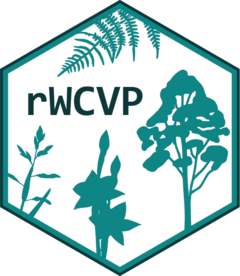

<!-- README.md is generated from README.Rmd. Please edit that file -->

```{r, include = FALSE}
knitr::opts_chunk$set(
  collapse = TRUE,
  comment = "#>",
  fig.path = "man/figures/README-",
  out.width = "100%"
)
```

# rWCVP <a href="https://matildabrown.github.io/rWCVP/"></a>

<!-- badges: start -->

<!-- badges: start -->

[](https://github.com/matildabrown/rWCVP/actions)

<!-- badges: end -->

<!-- badges: end -->

rWCVP is a package for accessing and using plant name and distribution data from the [World Checklist of Vascular Plants](https://powo.science.kew.org//)

<div style="background-color:#f7e3c4;overflow: auto; width: 600px;  border-left: 5px solid #e08604; text-color: black; padding: 10px; ">
 :warning: **The next version of rWCVP is currently in active development** - we will be back on CRAN soon! In the meantime, please install via GitHub (see below). </div>

## Installation

You can install the development version of rWCVP from [GitHub](https://github.com/) with:

``` r
devtools::install_github("matildabrown/rWCVP")
```

It's also best to install the most recent version of the accompanying data package, `rWCVPdata`:

``` r
devtools::install_github("matildabrown/rWCVPdata")
```

## Example

rWCVP makes it easy to get and plot the known distribution of plant species.

```{r example, eval=FALSE}
library(rWCVP)

distribution <- wcvp_distribution("Myrcia guianensis", taxon_rank = "species")

# global map
wcvp_distribution_map(distribution)

# zoomed-in map
wcvp_distribution_map(distribution, crop_map = TRUE)
```
